# PL Agent — target flow (phase 1: lead → signed → handover)

Legend
- **Trigger**: event from a system (HubSpot, Fathom, DocuSign, calendar).
- **Auto**: agent acts on its own (L2/L3).
- **Approve**: agent drafts, human approves in Slack (L1).
- **Human**: decision or work by a person.
- **New**: step that is not in today's process.

The Mermaid diagrams below render on GitHub and can be pulled into FigJam with
a Mermaid import plugin to keep editing visually.

## Overview

```mermaid
flowchart LR
  subgraph IN[Inbound]
    IN1([Content download]) --> IN1b{Existing client /<br/>open deal?}
    IN1b -- yes --> STOP1[Stop, notify owner]
    IN1b -- no --> IN1c[Enrich + ICP score]
    IN1c -- high fit --> IN2[[Slack alert to sales<br/>+ suggested first mail]]
    IN1c -- other --> IN3[Preference mail<br/>next working day]
    IN3 --> IN4{Click / reply /<br/>nothing?}
    IN4 -- click --> LISTS[(HubSpot consent + lists)]
    IN4 -- reply --> OWNER[Route to owner in Slack]
    IN4 -- nothing 5d --> IN5[One soft reminder, then stop]
  end

  subgraph OUT[Outbound]
    OUT1([Call logged<br/>with disposition]) --> OUT1b{Disposition}
    OUT1b -- no answer --> OUT2[[Follow-up mail draft<br/>meeting first, event second]]
    OUT1b -- not now, yes event --> OUT3[Confirmation mail<br/>+ event-interest list]
    OUT3 -.-> OUT4[[Event published →<br/>personal invites]]
    OUT1b -- meeting booked --> M1
  end

  IN2 --> M1
  OUT2 --> M1

  subgraph MEET[First meeting]
    M1([Meeting booked<br/>native invite]) --> M2[Prep brief to GM<br/>24h before]
    M2 --> M3{Attended?}
    M3 -- no-show --> M4[[Reschedule mail draft]]
  end

  M3 -- yes --> AM1

  subgraph AFTER[After meeting]
    AM1([Fathom recording ready]) --> AM2[[Recap draft in GM voice<br/>GM approves in Slack]]
    AM1 --> AM3[CRM update:<br/>notes, stage, tasks]
    AM2 --> AM4{GM picks next step}
    AM4 -- request access --> AM5[[Access requests +<br/>client checklist page]]
    AM5 --> AM6[Verify access via APIs<br/>reminders d3 / d7, escalate d10]
    AM4 -- send proposal --> PC1
    AM6 --> PC1
    AM4 -- nurture / lost --> NUR[Nurture or close lost]
  end

  subgraph CLOSE[Proposal & close]
    PC1[[Resourcing pre-check<br/>soft reservation]] --> PC2[Proposal by GM/sales]
    PC2 --> PC3([Deal → waiting for signature])
    PC3 --> PC4[[DocuSign envelope<br/>sales validates + sends]]
    PC4 --> PC5[Reminders d3 / d7]
    PC5 --> PC6([Signed webhook → Closed won])
    PC3 --> PC7[[CRM completeness:<br/>agent links, sales confirms gaps]]
  end

  subgraph HAND[Handover]
    PC6 --> H1[[Productive project + budget<br/>from quote lines]]
    PC6 --> H2[Planning lead confirms team]
    PC6 --> H3[[Handover pack + Slack channel<br/>+ kickoff invite draft]]
    H3 --> H4[Phase 2: delivery]
  end
```

`[[double box]]` = human approval gate in Slack. `([rounded])` = trigger.

## Step catalogue

| ID | Step | Kind | Agent | Human gate | Systems |
|---|---|---|---|---|---|
| IN1 | Content download → dedupe, enrich, score | Trigger + Auto | Nurture | — | HubSpot, Clay |
| IN2 | High-fit lead → Slack alert with brief + first mail | Approve (new) | Nurture | Sales | Slack, Outlook |
| IN3 | Preference mail with one-click links | Auto | Nurture | Template once | Outlook, HubSpot |
| IN4 | Reply → stop + route; no click → 1 reminder | Auto (new) | Nurture | — | Outlook, Slack |
| OUT1 | Call logged with mandatory disposition | Trigger | — | Sales logs | HubSpot |
| OUT2 | No answer → follow-up mail (meeting first) | Approve | Nurture | Daily digest | Outlook |
| OUT3 | Yes to event → confirmation + interest list | Auto | Nurture | — | HubSpot, Outlook |
| OUT4 | Event published → personal invites | Approve (new) | Nurture | Marketing | HubSpot, Outlook |
| M1 | Meeting booked → native invite, deal created | Trigger | — | — | HubSpot Meetings |
| M2 | Prep brief to GM 24h before | Auto (new) | Meeting | — | Clay, Meta Ad Library, HubSpot |
| M3 | No-show → reschedule draft | Approve (new) | Meeting | GM | Calendar, Fathom |
| AM1 | Recap draft from transcript | Approve | Meeting | GM | Fathom, Outlook |
| AM2 | CRM update after meeting | Auto (new) | Meeting | — | HubSpot |
| AM3 | Next step decision | Human | — | GM | Slack |
| AM4 | Access requests + checklist page | Approve | Access | GM (first mail) | Meta, Google, LinkedIn, landing page |
| AM5 | Access verified per platform | Auto (new) | Access | — | Platform APIs |
| PC1 | Resourcing pre-check (soft reservation) | Approve (moved) | Resourcing | Planning lead | Productive |
| PC2 | Proposal | Human | — | GM / sales | HubSpot |
| PC3 | DocuSign envelope from quote | Approve | Deal Desk | Sales | DocuSign, HubSpot |
| PC4 | Signature reminders + signed → Closed won | Auto (new) | Deal Desk | — | DocuSign, HubSpot |
| PC5 | CRM completeness (agent links, human confirms gaps) | Approve (changed) | Deal Desk | Sales | HubSpot, Fathom |
| H1 | Productive project + budget from quote | Approve | Deal Desk | Finance / PL | Productive |
| H2 | Team confirmed and booked | Human | Resourcing | Planning lead | Productive |
| H3 | Handover pack + Slack channel + kickoff draft | Approve (new) | PL Orchestrator | GM | Slack, Outlook |
| H4 | Delivery (phase 2, to be mapped) | — | — | — | — |
