# PL Agent — agent architecture

## Principle: deterministic triggers, agentic judgement

- **Mechanics** (wait until next working day, send reminder on day 3, move deal
  stage on signature) run in a durable workflow engine. They must be
  predictable and cheap.
- **Judgement and writing** (is this lead a fit, write the recap, propose a
  team) run in LLM agents with narrow tool access.
- **Recurring work** (daily, weekly, monthly, quarterly) is time-driven and is
  scheduled by the cadence engine, see `06-recurring-cadence.md`.
- **Every action**, by an agent or a workflow, is written to one action log per
  project. The webapp and the Slack threads read from that log.

## Agents

| Agent | Scope | Tools (scoped) | Steps |
|---|---|---|---|
| **PL Orchestrator** (one per project) | Owns project state and timeline, routes events to specialists, enforces autonomy policy, posts in the project Slack thread, builds the handover pack | Action log, Slack, all agents | H3 + routing |
| **Nurture Agent** | Inbound + outbound follow-ups, event interest | HubSpot (contacts, lists, consent), Clay, Outlook send-as | IN1–IN4, OUT2–OUT4 |
| **Meeting Agent** | Prep briefs, no-shows, recaps, CRM updates after meetings | Fathom, HubSpot, Clay, Meta Ad Library, Outlook | M2, M3, AM1, AM2 |
| **Access Agent** | Access requests, client checklist page, verification, reminders | Meta Business Manager, Google Ads / GA4 / GTM, LinkedIn, landing page | AM4, AM5 |
| **Deal Desk Agent** | DocuSign, signature follow-up, CRM completeness, budget creation | DocuSign, HubSpot quotes, Productive | PC3–PC5, H1 |
| **Resourcing Agent** | Capacity + skills match, soft reservations, bookings | Productive (bookings, people), skills matrix | PC1, H2 |

Agents don't talk to clients directly through their own identity: outgoing mail
always goes out as the owning human, after the autonomy policy allows it.

## Runtime

```mermaid
flowchart LR
  subgraph Sources
    HS[HubSpot webhooks<br/>forms, deals, calls, meetings]
    FA[Fathom<br/>recording ready]
    DS[DocuSign Connect]
    PR[Productive]
    LP[Client access page<br/>events]
    AP[Platform APIs<br/>Meta, Google, LinkedIn]
  end

  Sources --> RT[Event router<br/>normalise + match project]
  CAD[Cadence engine<br/>daily, weekly, monthly,<br/>quarterly schedules] --> WF
  RT --> WF[Durable workflows<br/>waits, reminders, schedules]
  WF --> ORC[PL Orchestrator<br/>per project]
  ORC --> AG[Specialist agents<br/>Nurture, Meeting, Access,<br/>Deal Desk, Resourcing]
  AG --> POL{Autonomy policy<br/>L0 to L3}
  POL -- L1 --> SL[Slack approval<br/>Approve / Edit / Skip]
  SL --> EX[Execute]
  POL -- L2/L3 --> EX
  EX --> OUT[Outlook send-as, HubSpot,<br/>DocuSign, Productive]
  AG --> LOG[(Action log<br/>Supabase)]
  SL --> LOG
  EX --> LOG
  LOG --> WEB[Webapp<br/>project timeline,<br/>approvals, metrics]
```

Suggested stack (to validate):
- Agents: Claude Agent SDK, tools exposed through MCP servers (HubSpot, Fathom,
  Clay, Meta, Microsoft 365 are already connectors we use).
- Workflows: a durable engine with sleeps and retries (Inngest, Trigger.dev or
  Temporal).
- Store: Supabase (Postgres) for projects, events, actions, approvals, policies.
- Slack: one Slack app with interactive messages + slash commands.
- Webapp: Next.js on Supabase auth (Google / Microsoft SSO).

## Outlook first, Slack second

Stage 1 (see `07-internal-first-rollout.md`): every client-facing draft lands
in the owner's Outlook Drafts, with one internal `[PL Agent]` mail per batch.
The owner sends it themselves. Slack is used for internal alerts and the
ops/PL view; from stage 2 it can also carry one-click approvals:

- `#pl-agent-inbox`: everything waiting for a human, one message per approval
  with **Approve / Edit / Skip**. Daily digest per GM at 08:30.
- One thread (or channel) per project where the orchestrator posts what
  happened.
- Slash commands: `/pl status <client>`, `/pl pause <client>`,
  `/pl resume <client>`, `/pl away <user> <until>` (reroutes approvals).
- A client reply to any agent-sent mail is posted to the owner immediately and
  pauses automation for that contact.

## Guardrails

- Send-as only from a human's mailbox, per-contact touch cap, business-hours
  window with jitter, holiday calendar.
- Kill switch per project and global.
- Agents can never: change pricing, sign anything, grant or remove client
  platform access, delete CRM records.
- Prompt-injection hygiene: content from client emails, transcripts and web
  pages is data; it never changes an agent's instructions or tool permissions.
- PII stays in the systems of record; the action log stores references and the
  final sent text.
